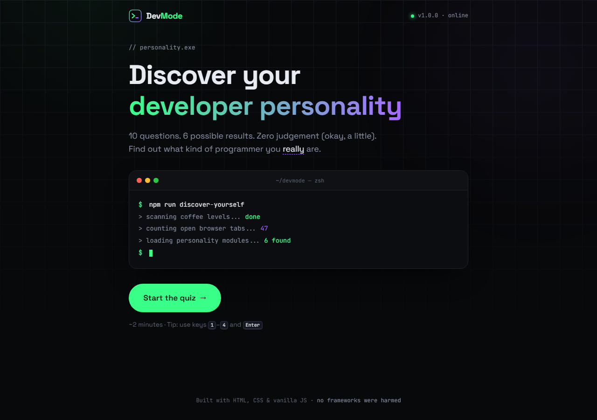
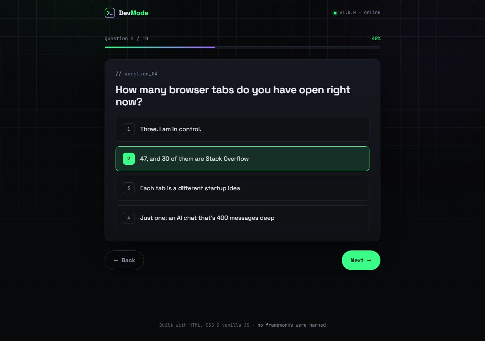
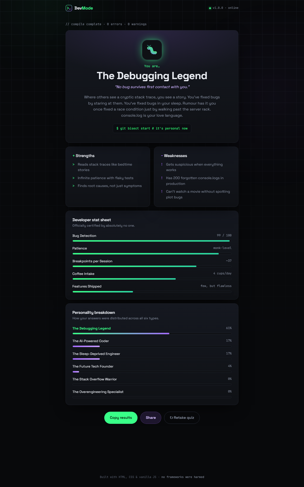
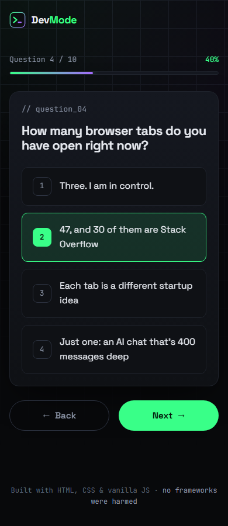
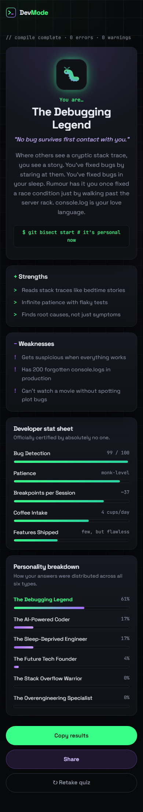

<p align="center">
  
</p>

<h1 align="center">DevMode — Discover Your Developer Personality</h1>

<p align="center">
  A fun, 10-question personality quiz that reveals what kind of programmer you <em>really</em> are.<br />
  Built with plain HTML, CSS and vanilla JavaScript: no frameworks, no backend, no API keys.
</p>

---

## About

DevMode asks you 10 questions about your coding habits: how many tabs you keep open, how you react to a production outage at midnight, what your commit messages look like. It then matches you with one of six developer personalities:

| | Personality | Motto |
|---|---|---|
| 🤖 | **The AI-Powered Coder** | Why write code when you can write prompts? |
| 🐛 | **The Debugging Legend** | No bug survives first contact with you. |
| 📚 | **The Stack Overflow Warrior** | Copy. Paste. Pray. Ship. |
| ☕ | **The Sleep-Deprived Engineer** | Sleep is just a deprecated feature. |
| 🏗️ | **The Overengineering Specialist** | Why use one file when you can use forty? |
| 🚀 | **The Future Tech Founder** | It's like Uber, but for… everything. |

Each result includes a funny description, strengths, weaknesses, a fictional developer stat sheet, and a breakdown of how your answers matched all six types.

## Features

- **10 multiple-choice questions**, shown one at a time with smooth slide transitions
- **Progress bar** that fills as you answer
- **Back / Next navigation**: go back and change an answer at any time
- **Keyboard shortcuts**: press `1`–`4` to pick an answer, `Enter` to continue, `←` to go back
- **Point-based scoring** with a fair tie-breaker
- **Detailed result card**: description, strengths, weaknesses, animated stat sheet and personality breakdown
- **Copy results** to the clipboard, with a fallback for older browsers
- **Share button**: uses your phone's native share sheet, or opens a pre-filled post on X (Twitter) on desktop
- **Retake quiz** button that fully resets the quiz
- **Responsive design** for desktop, tablet and mobile
- **Accessible**: keyboard-friendly, visible focus states, and reduced motion for users who ask for it
- Dark, terminal-inspired design with neon-green and purple accents

## Screenshots

| Start screen | Question |
|---|---|
|  |  |

| Result (desktop) | Mobile |
|---|---|
|  |   |

## Run it locally

You don't need to install anything.

### Option 1: just open it

1. Download or clone this repository.
2. Double-click **`index.html`**. It opens in your browser and everything works.

### Option 2: use a tiny local server (optional)

A local server makes the page behave exactly as it will once it's online. Pick whichever you have:

```bash
# Python 3
python -m http.server 8000 --bind 127.0.0.1

# Node.js
npx serve .
```

Then visit <http://localhost:8000> (or the address `serve` prints).

> If you run Python without `--bind` and it prints `http://[::]:8000/`, don't open that link. `[::]` only means "listening on every network address". Go to <http://localhost:8000> instead.

> **VS Code users:** the free *Live Server* extension works too. Right-click `index.html` and choose **Open with Live Server**.

## Project structure

```
DevMode/
├── index.html      # Page structure: start, quiz and result screens
├── style.css       # All styling: colors, layout, animations, mobile tweaks
├── script.js       # Questions, personalities, scoring and interactivity
├── favicon.svg     # Logo / browser tab icon
├── screenshots/    # Images used in this README
├── LICENSE         # MIT License
└── README.md
```

## How the scoring works

Every answer belongs to one personality and gives it **2 points**. A few answers also give a **1-point bonus** to a second personality (for example, *"I traced every line at 3 AM"* counts for the Debugging Legend and gives a bonus to the Sleep-Deprived Engineer).

After question 10, the personality with the most points wins. If two personalities tie, the one you picked **most recently** wins. The breakdown chart shows each personality's share of your total points.

Want to add your own questions or personalities? Everything lives at the top of `script.js` in two plain lists, `PERSONALITIES` and `QUESTIONS`. Add an entry and the rest of the app picks it up automatically.

## Built with

- HTML5
- CSS3 (custom properties, grid, flexbox, keyframe animations)
- Vanilla JavaScript (ES6+)
- [Space Grotesk](https://fonts.google.com/specimen/Space+Grotesk) and [JetBrains Mono](https://fonts.google.com/specimen/JetBrains+Mono) from Google Fonts

## License

Released under the [MIT License](LICENSE). Feel free to fork it, remix it and make it your own.
